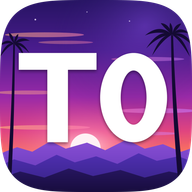

<!-- t0:keep-start (tools/rebrand.mjs leaves this README alone; on upstream syncs keep this version) -->

<p align="center">
  
</p>

<h1 align="center">T0 Code</h1>

<p align="center">A GUI for coding agents, without telemetry.</p>

> **T0 Code is an unofficial fork of [T3 Code](https://github.com/pingdotgg/t3code).** It is not
> affiliated with, endorsed by, or maintained by T3 Tools, Inc.

T0 Code runs the coding agents on your machines and gives them one fast interface: Claude Code,
Codex, Cursor, OpenCode, Grok Build, Antigravity, Kiro, Pi, Muse Code, fx, and any
[ACP](./docs/user/providers-acp.md) agent. If an agent is set up on a computer, T0 Code can control
it.

How it differs from T3 Code:

- **No telemetry.** No usage analytics, crash reports, connection tracing or update lookups to
  upstream's services.
- **No cloud relay.** T3 Code's cloud service (T3 Connect) is removed. Reach other machines over
  your local network, your tailnet (Tailscale or a self-hosted [headscale](https://headscale.net)
  server) or SSH.
- **Its own name.** The command is `t0c`, its data lives in `~/.t0c`, so T0 Code and an installed
  T3 Code never share a database.

## Install

### Desktop app

Download the installer for your system from
[Releases](https://github.com/wintelous/t0code/releases/latest):

| System                 | File                                                      |
| ---------------------- | --------------------------------------------------------- |
| macOS (Apple silicon)  | `T0-Code-<version>-arm64.dmg`                             |
| macOS (Intel)          | `T0-Code-<version>-x64.dmg`                               |
| Windows                | `T0-Code-<version>-x64.exe`                               |
| Debian, Ubuntu         | `.deb` (`sudo apt install ./T0-Code-<version>-amd64.deb`) |
| Fedora, RHEL, openSUSE | `.rpm`                                                    |
| Arch Linux             | `.pacman` (`sudo pacman -U T0-Code-<version>-x64.pacman`) |
| Any Linux              | `.AppImage`                                               |

The builds are not code-signed yet. On macOS, if the first launch is blocked, allow it in System
Settings › Privacy & Security, or run:

```bash
xattr -dr com.apple.quarantine "/Applications/T0 Code (Beta).app"
```

On Windows, SmartScreen may ask you to confirm with **More info** › **Run anyway**.

### Sign in to an agent

T0 Code needs one agent that is installed and signed in. For example, install
[Claude Code](https://claude.com/product/claude-code) and run `claude auth login`, or install
[Codex CLI](https://developers.openai.com/codex/cli) and run `codex login`.
[Provider setup](./docs/user/install.md#providers) has the steps for each agent.

## Agents on other machines

Any machine that runs the T0 Code server can host agents. Use one of:

- **SSH.** In the desktop app, add an environment, choose **SSH**, and enter the host or SSH alias.
  T0 Code installs its server there from this repository's releases (Linux x64, Apple-silicon Macs
  and Windows x64) and tunnels to it.
- **Tailnet or local network.** On the other machine, run `t0c up --lan` (a background service) or
  `t0c serve --lan`, then `t0c pair` and open the pairing link from your desktop or phone.
- **Tailscale HTTPS.** `t0c serve --tailscale-serve` and `t0c pair --tailscale` give the machine an
  `https://<machine>.<tailnet>.ts.net/` address. This needs Tailscale's own coordination service;
  a headscale tailnet uses plain HTTP inside the encrypted tailnet instead.

[Remote access](./docs/user/remote-access.md) has the details.

## Documentation

- [Install and first run](./docs/user/install.md)
- [Remote access](./docs/user/remote-access.md)
- [Permission modes](./docs/user/permission-modes.md)
- [Source control](./docs/user/source-control.md)
- [Connect outside agents over MCP](./docs/user/outside-agents.md)
- [All docs](./docs/README.md)

Some pages still describe upstream features that T0 Code removed, such as the cloud relay.

## Building from source

See the [development runbook](./docs/operations/00_development.md#first-checkout). The
[architecture overview](./docs/internals/01_architecture.md) explains how it works.

## License

The source code in this repository is licensed under the [MIT License](./LICENSE), like T3 Code's.

## Trademarks

T3 Code's name, wordmark, logos and icons are trademarks of T3 Tools, Inc. (see
[TRADEMARK.md](./TRADEMARK.md)). T0 Code uses its own name, mark and icons and is not an official
version of T3 Code.

<!-- t0:keep-end -->
